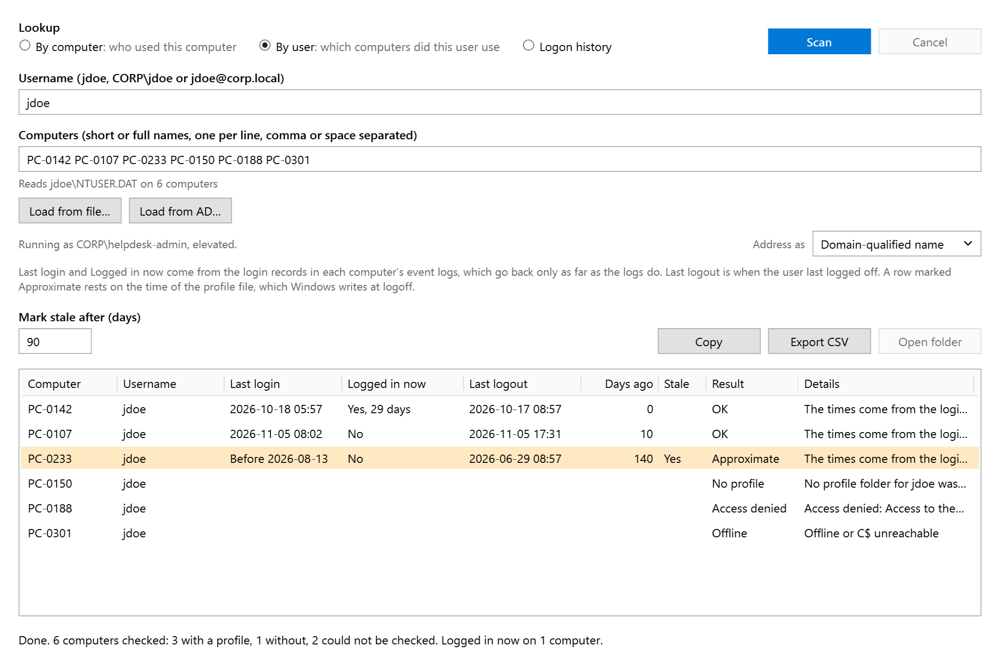

# LastLogon

A Windows tool for support staff. It answers three questions about remote computers:

- **Who used this computer, and when?**
- **Which computers did this user use?**
- **Who is logged in right now, and since when?**



The screenshot uses made-up computer names, a made-up domain and a made-up user.

## Lookup modes

- **By computer:** every user profile on a computer, with the user's last login, whether the user is logged in now and since when, and the last logout. Users who are logged in come first, then the newest.
- **By user:** the computers from a list that have a profile for one user, with the same facts for each. Every computer checked gets a row: a profile found, no profile, or the reason it could not be checked. The status line gives the totals and how many computers the user is logged in on, for example `Done. 6 computers checked: 3 with a profile, 1 without, 2 could not be checked. Logged in now on 1 computer.`
- **Logon history:** logon, logoff, lock, unlock, failed-logon and special-logon events from the remote Security log. You can filter by account and logon type, select an event to see all its fields, and export to CSV.

Access-denied rows also show the address each computer name resolves to. That separates a refused account from a name that reaches a different computer.

In **By user** and **Logon history** you type or paste the computer names, or fill the box with **Load from file…** (a text or CSV file) or **Load from AD…** (a name prefix and an optional OU). Loading replaces what is in the box, and Ctrl+Z in the box brings it back.

Working with the results:

- Select a row to read its full message under the table. Rows that are long are cut off in the table itself, and a tooltip shows the whole of a long computer or user name.
- Click a column heading to sort, and click it again to reverse the order.
- Double-click a profile row, or right-click it, to open the profile folder or copy the computer name.
- **Copy** and Ctrl+C copy the selected rows, or every row when none is selected. **Export CSV** writes every row. Both follow the order the table is sorted in.
- Esc cancels a scan that is running.

## Read the results with care

- **Last login** and **Logged in now** come from the login and logout records in each computer's System and User Profile Service event logs. Windows writes them without an audit policy, and keeps them only as far back as the logs go: `Before 2026-05-12` means no login since the logs begin on that date, and `Yes, over 185 days` means a user who has been logged in since before they begin. Whether a user is logged in is settled by whether Windows holds the profile open.
- A row marked **Approximate** rests on the time of the profile file (`NTUSER.DAT`, which Windows writes at logoff) because the login records could not be used. Its Details say why: the logs could not be read, hold no login or logout record at all, or could not be matched to the profile folder. For someone who is still logged on, that time is the previous logoff, not the current time.
- **A missing record is not proof** that a user never used a computer. Profiles get cleaned up, folders can carry a domain suffix, and event logs are overwritten.

## Requirements

- Windows 10 or 11, 64-bit.
- The **.NET 10 Desktop Runtime** for the framework-dependent download. A computer that has only the .NET 8 runtime cannot start it. Microsoft supports .NET 10 until 14 November 2028. The self-contained build in [docs/publishing.md](docs/publishing.md) avoids needing the runtime.
- Run the tool as an administrator. The account you use needs administrator rights on each target computer.
- For the login times in **By computer** and **By user**, the target computers need the *Remote Event Log Management* firewall rules enabled. No audit policy is needed. Without the rules both lookups still work and show what they showed before, with the rows marked Approximate and the reason in Details.
- For **Logon history**, the same firewall rules, and logon auditing turned on.

## Download

Get the latest build from the [Releases](https://github.com/yanzhou-ca/LastLogon/releases) page. Check the file against the SHA-256 value published with the release.

The executable is not code-signed, so Windows SmartScreen may warn the first time you start it.

## Build from source

You need the .NET 10 SDK on Windows.

```powershell
dotnet restore LastLogon.slnx --use-lock-file
dotnet build LastLogon.slnx -c Release --no-restore
dotnet test LastLogon.Tests/LastLogon.Tests.csproj
dotnet publish LastLogon.csproj -c Release -p:Platform=x64 -r win-x64 --no-restore
```

The published file is written to `publish\win-x64\LastLogon.exe`. [docs/publishing.md](docs/publishing.md) describes the other publish profiles, including a self-contained build that needs no runtime.

## Project layout

- `LastLogon.Core/`: the scanning and filtering logic, with no user interface.
- `ScanWindow.xaml` and `ScanWindow.xaml.cs`: the WPF window. `AdDialog.xaml` is the Active Directory search, and `Styles.xaml` holds the look the two share.
- `LastLogon.Tests/`: the unit tests.
- `docs/`: the publishing guide and the sample screenshot.

## Behaviour and limits

- The tool only reads. It changes nothing on the computers it checks. To see whether a user is logged in it briefly opens that profile's `NTUSER.DAT` for reading and closes it again, and it reads the access list of each profile folder to match the login records to the folder. It does not do the first for a user whose records say they logged out.
- The login records of a computer are read under a time limit of their own (10 seconds), and at most 20,000 records are read from each log.
- It uses the Windows identity you run it under. It stores no credentials.
- Each computer gets a time limit, and a scan returns at most 50,000 events per computer. A partial result is marked as such.

## Status

Copyright (C) 2026 Yan.

LastLogon is free software, licensed under the [GNU General Public License, version 3 or later](LICENSE). You may use, study, change and share it under those terms. The program comes with no warranty.
